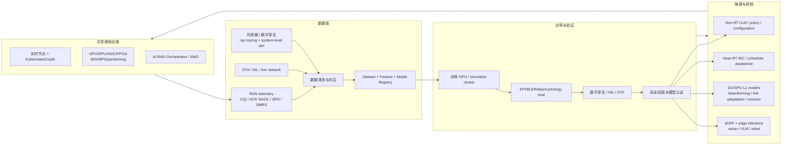
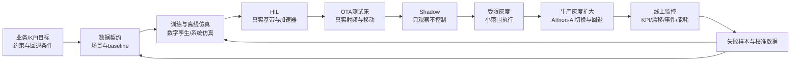

# AI-RAN 训练、模型与推理基建

**一句话**：2026 年 AI-RAN 的产业焦点已经从“AI 能不能优化 RAN”转向**能不能在共享加速基础设施上稳定完成数据采集、模型训练、实时推理、AI/RAN 资源调度、SLA 保障和商业变现**。

本页是 [[wiki/concepts/ai-ran|AI-RAN]] 的进阶篇，重点回答五个问题：

1. AI-RAN 的数据从哪里来，如何训练？
2. 模型通常放在 RAN 协议栈哪一层？
3. GPU/ASIC/FPGA、云/边/站点算力怎么分工？
4. 大厂目前给出了哪些架构和量化结果？
5. 国内外进展有什么差异？

若要把这些模型逐个映射回传统 RAN 的 PHY/MAC/RRC/运维功能块，见 [[wiki/concepts/ai-ran-training-model-ran-function-mapping|AI-RAN 训练模型与传统 RAN 功能映射]]。

> 证据边界：本页混合了官方白皮书、厂商博客、联盟 demo 和研究简报。凡“1.62x、3x、219% ROI、sub-10 ms”等数字都应视为**厂商/联盟宣称或场景估算**，不能等同第三方全网商用基准。

## 2026 年产业进展总览

| 时间/来源 | 关键进展 | 为什么重要 |
|---|---|---|
| 2024 AI-RAN Alliance 成立 | Arm、Nokia、Ericsson、Samsung、NVIDIA、Microsoft、SoftBank、T-Mobile 等参与 | 把 AI-for-RAN、AI-and-RAN、AI-on-RAN 变成跨厂商议题 |
| 2025 NTT DOCOMO GPU Open RAN | NVIDIA/Fujitsu/Wind River 支持全球首个 GPU-accelerated 5G Open RAN | 证明 GPU 可承担基带负载，为 AI/RAN 共享算力打开门 |
| 2025 SoftBank AI-for-RAN 实测 | UL 信道插值 +20%、80 km/h SRS 预测 +13%、MAC scheduling +8% | 把 AI-for-RAN 从概念落到信道估计、SRS 和调度 |
| 2026 MWC Barcelona | 132 成员、33 demo、4 blueprints | 覆盖空口模型、orchestrator、D4AI、数字孪生、边缘 AI |
| 2026 D4AI/Test Methodology | VIAVI/VALOR、Data Quality Validation for AI-RAN | 开始解决训练数据质量、数据共享和可复现测试 |

来源见 [[wiki/sources/ai-ran-alliance-mwc-2026-progress|MWC 2026 进展]]、[[wiki/sources/softbank-ai-for-ran-verification|SoftBank 实测]] 与 [[wiki/sources/avidthink-ai-in-mobile-ran|AvidThink 产业报告]]。

## 一张图理解 AI-RAN 的模型基建



## 数据与训练方法

### 1. 数据来源

AI-RAN 模型的输入不是普通互联网语料，而是强物理含义的网络数据：

| 数据类型 | 典型字段 | 支撑什么模型 |
|---|---|---|
| 无线测量 | CQI、RSRP/RSRQ/SINR、SRS、DMRS、ACK/NACK | 信道估计、链路自适应、波束赋形 |
| 调度与协议事件 | MCS、HARQ 重传、调度请求、缓存队列、小区负载 | MAC 调度、资源分配、重传预测 |
| 网管/运维 | 告警、日志、KPI、配置、工单 | AIOps、根因分析、预测性维护 |
| OTA/硬件在环 | 真实射频、功放非线性、移动轨迹、干扰 | neural receiver、数字预失真、泛化验证 |
| 数字孪生/仿真 | 射线追踪传播、小区几何、流量回放 | 模型预训练、反事实测试、波束/倾角优化 |

AI-RAN Alliance 的 MLOps & Data Platform 要求覆盖数据采集、准备、训练、评估、部署、监控和治理。MWC 2026 的 Samsung/Keysight/NVIDIA/HPE PUSCH demo 明确展示了 Data-for-AI workflow。见 [[wiki/sources/ai-ran-alliance-mwc-2026-progress|MWC 2026 进展]]。

### 2. 数据质量是第一瓶颈

VIAVI 在 AI-RAN Alliance spotlight 中说得很直接：AI systems are only as good as the data used to train and validate them。其 Data-for-AI Task Group 聚焦合成数据生成、真实网络数据采集、清洗、适配性验证和可信数据管道；VALOR 被定位为 NTIA 资助、首个正式关联联盟的 vendor-neutral lab。

AvidThink 还指出，运营商数据因隐私和合规难以直接共享，初创公司很难拿到大规模训练语料；联盟/O-RAN 可以在数据策展、归一化、脱敏和数据集托管上发挥作用。来源见 [[wiki/sources/ai-ran-alliance-mwc-2026-progress|MWC 2026 进展]] 与 [[wiki/sources/avidthink-ai-in-mobile-ran|AvidThink 产业报告]]。

本库把 AI-RAN 的数据资产分为四级。第一级“脱敏现场数据”最接近真实分布，但通常量少、敏感且难以覆盖长尾场景。第二到第四级正是为了解决这些缺口：

1. **脱敏现场数据**：用于训练特定站点/频段模型。
2. **合成信道数据**：补充罕见场景，如高速、深衰落、强干扰。
3. **数字孪生回放数据**：测试策略但避免影响生产网。
4. **联邦/梯度级数据**：不移动原始数据，只聚合模型更新。

> 这个四级划分是研究综合，不是 AI-RAN Alliance 官方分类。工程实现时，同一份仿真产物既可能作为“合成信道样本”，也可能进入“数字孪生场景”，边界要看数据契约。

### 2.1 合成信道数据：造出罕见但物理合理的样本

**一句话**：合成信道数据用物理/统计模型或 ray tracing 生成“如果信道这样，接收信号就会这样”的训练样本，用来补真实网络里少、难标、危险或敏感的场景。

**怎么产生**：

1. 从 3D 场景、建筑材料、天线位置、载频、带宽、numerology、UE 轨迹出发；
2. 用统计信道模型或 ray tracing 计算多径、时延扩展、多普勒、遮挡和反射；
3. 叠加噪声、干扰、相位误差、功放非线性等损伤；
4. 把 CIR/信道矩阵/频域响应注入链路仿真，生成 IQ 样本、DMRS/SRS、LLR、BLER 或调度标签；
5. 记录完整 metadata：频段、SCS、天线数、移动速度、SNR、随机种子、标签规则和仿真版本。

NVIDIA Sionna 是典型开源工具链：官方页面描述它是 GPU 加速、可微分通信系统研究库，包含 radio-propagation ray tracer、link-level simulator 和 system-level simulation，可把神经网络接入端到端通信系统。见 [[wiki/sources/nvidia-sionna-aodt-simulation-data|NVIDIA Sionna/AODT 仿真数据]]。

**输入/输出例子**：

```text
输入：
  3D 工厂模型（金属货架、墙体、AGV 轨迹）
  + 64T64R 天线阵列 + 3.5 GHz + 30 kHz SCS
  + 80 km/h 或 5 km/h 移动场景
  + 邻区干扰和热噪声

输出：
  CIR / H 矩阵 / 频域信道响应
  + 合成 DMRS/SRS/IQ
  + 标签：真实信道、最优 MCS、可达 SINR
  + metadata：场景、随机种子、损伤配置
```

**用于 AI-RAN 哪些环节**：

| 环节 | 用法 |
|---|---|
| 信道估计/SRS 预测 | 预训练插值/预测模型，再导入少量现场数据微调 |
| Neural receiver | 生成低 SNR、强干扰、非线性、高速场景的 IQ/LLR 样本 |
| Link adaptation | 合成不同 CQI/BLER 轨迹，教模型学习“激进/保守”边界 |
| Beam management | 补充遮挡、绕射、切换边界等罕见波束状态 |

**最终解决什么问题**：真实网络很难天然覆盖 80 km/h 高速、深衰落、金属工厂、邻区强干扰、功放非线性同时出现的样本。合成数据先扩大训练覆盖面，降低数据采集成本和隐私风险。

**主要风险**：sim-to-real gap。仿真可能没有准确表达功放非线性、真实天线方向图、邻区调度行为、人群遮挡和设备缺陷。因此合成数据用于预训练和压力测试，最终仍要经过 HIL/OTA/灰度验证。

### 2.2 数字孪生回放数据：造出可反复实验的网络状态机

**一句话**：数字孪生回放数据不是一条条孤立信道样本，而是带时间轴的“虚拟小区/虚拟网络”运行记录；它回答“如果这样配置、这样调度、这样移动，KPI 会怎样”。

**怎么产生**：

1. 输入真实或规划网络拓扑：站址、天线、频段、功率、邻区关系、BWP/TDD pattern、负载；
2. 用 ray tracing/EM 仿真产生传播环境；
3. 接入或模拟 5G RAN 栈、UE/AGV/行人移动模型、流量模型和调度器；
4. 用真实 telemetry/KPI 校准模型，使覆盖、吞吐、干扰或能耗接近现场；
5. 反复执行 baseline、AI 模型、参数变更或故障注入，输出时间序列和反事实结果。

NVIDIA AODT 官方描述支持从 single tower 到 full cities 的 physically accurate virtual 5G/6G wireless network；其文档包含 EM simulation、RAN simulation、scene building、calibration、mobility model、output schemas 和 waveform dumps。见 [[wiki/sources/nvidia-sionna-aodt-simulation-data|NVIDIA Sionna/AODT 仿真数据]]。AI-RAN Alliance MWC 2026 也有 Oulu/NVIDIA multimodal digital twins 和 Hanyang/Keysight/VIAVI beam tracking、tilt optimization demo。见 [[wiki/sources/ai-ran-alliance-mwc-2026-progress|MWC 2026 进展]]。

**输入/输出例子**：

```text
输入：
  20 个小区的站址/邻区/天线倾角/功率
  + 3 类 UE 轨迹（行人、车载、AGV）
  + 真实小时级流量和 QoS profile
  + baseline scheduler 与候选 AI scheduler

输出：
  每秒/每 slot 的用户 SINR、CQI、PRB、MCS
  + 吞吐、BLER、HARQ、切换、p99 时延
  + 小区能耗、干扰图、掉线/排队事件
  + “如果换策略 B”的反事实 KPI
```

**用于 AI-RAN 哪些环节**：

| 环节 | 用法 |
|---|---|
| MAC 调度/资源编排 | 在虚拟网络中跑 PF、max C/I、AI scheduler，看小区/边缘/QoS 效果 |
| 波束与倾角优化 | 测试不同 tilt/beam pattern 对覆盖-干扰-容量的反事实影响 |
| 节能 | 回放夜间/潮汐流量，比较载波关断、通道关断和提前唤醒策略 |
| 移动性 | 高速/密集人流下测试切换参数，避免直接在生产网制造掉话 |
| 编排器测试 | 模拟 RAN/AI workload 抢占 GPU，验证 SLA、隔离和回退 |

**最终解决什么问题**：很多策略不能直接上生产网试错：切换参数改错会掉话，节能策略会伤 QoS，调度算法可能饿死边缘用户。数字孪生把“影响生产网的真实实验”变成“可回放、可重复、可注入故障的反事实实验”。

**主要风险**：模型保真度。孪生可以复现大体趋势，但未必精确复现某天某基站的异常。必须记录校准误差、scenario coverage、traffic profile 和版本；决策只应在验证过的边界内使用。

更完整的生成流程、合成数据/仿真/测试差异、训练与验证拆分和 AODT/Colosseum 落地方案，见 [[wiki/concepts/ai-ran-digital-twin-replay-data|AI-RAN 数字孪生回放数据]]。

### 2.3 联邦/梯度级数据：让数据留在本地，只聚合模型更新

**一句话**：联邦/梯度级数据不等于新业务数据，而是把“本地训练产生的模型参数、梯度/更新、局部统计和评估指标”作为可交换资产，用来在不集中原始网络数据的情况下得到跨站点模型。

**怎么产生**：

1. 每个站点/RIC/边缘节点先在本地数据上训练，例如 CSI 预测、流量预测、切片资源分配或能耗模型；
2. 只导出模型 delta、梯度、参数摘要、局部准确率/KPI，尽量不导出原始 CDR、用户轨迹、IQ 或业务内容；
3. 中心聚合器用 FedAvg/FedProx/split learning 等方法聚合成全局模型；
4. 结合安全聚合、签名、准入、审计、差分隐私或模型水印控制风险；
5. 全局模型再分发到各站点做 shadow/灰度验证。

O-RAN 论文样本说明这不是抽象概念：O-RAN 的 Non-RT/Near-RT RIC 可以用联邦学习训练模型；split federated learning 会把部分模型层从 Near-RT RIC 卸载到 Non-RT RIC，但数据/梯度传输带来通信成本；另有论文用 federated DRL 协调功率控制与切片资源分配 xApp，或在 mmWave 车联网 CSI 预测中用本地 CSI/C-V2X 数据联邦训练。见 [[wiki/sources/oran-federated-learning-papers|O-RAN 联邦学习论文样本]]。

**输入/输出例子**：

```text
站点 A：
  本地输入：隧道场景 CSI/SRS、车速、RSRP
  本地模型：CSI prediction MLP
  上传：ΔθA = θA - θglobal，样本数 10,000，验证 MAE 0.08

站点 B：
  本地输入：高架/多普勒场景 CSI/SRS
  上传：ΔθB、样本数 8,000、验证 MAE 0.11

聚合器：
  输入：ΔθA、ΔθB、ΔθC...，站点权重/质量分
  输出：θglobal_new、聚合指标、模型版本
  不应有：站点 A 原始用户轨迹或业务内容
```

**用于 AI-RAN 哪些环节**：

| 环节 | 用法 |
|---|---|
| Non-RT RIC / SMO | 聚合跨站点流量预测、切片策略、节能和配置建议 |
| Near-RT RIC | 聚合本地 CSI/干扰/移动性模型，避免原始测量大规模上行 |
| MAC/RLC 之外的策略层 | 训练 QoS 预测、准入控制、异常检测、能耗策略 |
| L1 附近的模型 | 常用“本地适配 + 全局预训练”，但要严格验证实时性和通信开销 |

**最终解决什么问题**：运营商数据往往不能集中，初创/设备商也难拿到全网分布；但单站点模型又容易过拟合。联邦/梯度级协作让模型看到跨城市、跨频段、跨场景的多样性，同时保留数据主权、降低合规压力和回传成本。

**主要风险**：

1. **非 IID**：隧道、体育场、高铁、工厂分布完全不同，平均模型可能伤害某些站点；
2. **通信成本**：大模型梯度可能挤占 RIC/回传带宽；
3. **时间尺度**：Near-RT 不能等待分钟级全局聚合；
4. **隐私残余**：梯度也可能泄露样本特征，需要安全聚合/差分隐私/访问控制；
5. **投毒与漂移**：恶意或异常站点更新会污染全局模型，需要签名、异常检测和回滚；
6. **可解释审计**：必须知道这个模型版本来自哪些站点、哪些数据范围和哪些 KPI。

更完整的 FedAvg/FedProx/Secure Aggregation 机制、“本地模型为什么要聚合”、O-RAN 部署位置和工程框架，见 [[wiki/concepts/ai-ran-federated-gradient-data|AI-RAN 联邦/梯度级数据]]。

### 2.4 三类资产放在一起看

| 维度 | 2 合成信道数据 | 3 数字孪生回放数据 | 4 联邦/梯度级数据 |
|---|---|---|---|
| 本质 | 物理/statistical/ray-tracing 造出的信道/链路样本 | 标定后的虚拟网络随时间运行的状态/事件/KPI | 本地训练产生的参数、梯度、指标 |
| 生成核心 | 几何/材质/波形/噪声/移动模型 + 仿真器 | 站点拓扑 + RAN 栈 + 流量/移动模型 + telemetry 校准 | 本地训练 + 参数/梯度聚合 |
| 典型粒度 | 一条 CIR、H 矩阵、IQ、DMRS/SRS、标签 | 一段时间的小区/UE/KPI/事件轨迹 | 一个模型 delta、梯度、局部统计 |
| 主要阶段 | 预训练、压力测试、罕见场景增强 | 策略评估、反事实实验、故障注入、灰度前筛选 | 跨站点泛化、隐私协作、持续学习 |
| 适合模型 | channel estimation、neural receiver、link adaptation、beam model | scheduler、节能、移动性、编排器、根因分析 | CSI/流量预测、切片策略、能耗策略、xApp/rApp 协同 |
| 隐私特征 | 可避开真实用户数据，但要防场景/拓扑泄露 | 可避开原始用户，但仍含运营拓扑/配置/负载敏感信息 | 原始数据留本地；梯度仍可能泄露，需要保护 |
| 最大风险 | sim-to-real gap | 校准误差、环境泛化、计算成本 | 非 IID、通信开销、投毒、收敛不稳 |
| 不能替代 | OTA/HIL 验证 | 生产网 A/B 和真实 SLA 验证 | 本地高质量数据、标准评估和安全治理 |

**共同目标**：把 AI-RAN 训练从“只有少量敏感现场数据”升级为四层证据链：

```text
现场数据保真
+ 合成数据补覆盖
+ 数字孪生做安全反事实
+ 联邦协作补跨站点分布
→ HIL/OTA/shadow/灰度验证
→ 可部署、可回滚、可审计的 AI-RAN 模型
```

**一句话收束**：合成数据解决“没见过、不好采、不好标”；数字孪生解决“不能在生产网乱试”；联邦/梯度数据解决“原始数据不能集中，但模型必须跨站点变强”。三者都最终服务同一个闭环：更快、更安全、更可信地训练和验证 AI-RAN。

1. **脱敏现场数据**：用于训练特定站点/频段模型。
2. **合成信道数据**：补充罕见场景，如高速、深衰落、强干扰。
3. **数字孪生回放数据**：测试策略但避免影响生产网。
4. **联邦/梯度级数据**：不移动原始数据，只聚合模型更新。

### 3. 训练、仿真、OTA 和线上部署的闭环

**一句话**：成熟方法不是“线下训练后直接上基站”，而是让同一个模型及其证据包，依次穿过**仿真、硬件、真实射频、影子观察、小范围现网、生产治理**这些闸门；每一关都会产生新的失败样本和校准数据，再反过来改进模型、仿真器和部署策略。

可以用“新药上市”类比：实验室有效不等于动物安全，动物安全不等于人体安全；小规模人体试验通过后，上市后还要继续做药物警戒。AI-RAN 的模型也一样，不同关卡回答的是不同问题：

| 阶段 | 核心问题 | 不能证明的问题 |
|---|---|---|
| 离线仿真/数字孪生 | 数学上是否可行？在哪些场景会失败？ | 真实功放、天线、实时调度和异常设备是否会出问题 |
| HIL | 真实基带/加速器能否按时算完？硬件损伤下是否仍有效？ | 真实空口、真实移动和邻区干扰是否足够覆盖 |
| OTA 测试床 | 真实射频环境中波束、移动性和干扰表现如何？ | 全网分布、真实业务高峰和运营边界是否安全 |
| Shadow 模式 | 如果模型真的给建议，它和现网算法的差距是什么？分布是否漂移？ | 建议被执行后是否会引起连锁反应 |
| 受限灰度 | 小范围执行后，KPI、SLA 和回退链路是否真的可用？ | 大范围、跨厂商、跨负载下是否长期稳定 |
| 生产运行 | 持续运行中如何监控、限权、切换和再训练？ | 不需要持续治理 |

#### 3.1 先定义“闭环”到底在循环什么



闭环里至少有四个循环：

1. **模型循环**：训练出来的模型不达标，就回训练；通过训练但 HIL/OTA 不达标，就继续训练或改特征。
2. **仿真器循环**：线上发现某种隧道、体育散场、金属厂房或异常 UE 被仿真低估，就把这类场景加入数字孪生和回归测试集。
3. **策略循环**：模型增益在高峰、午夜、边缘用户或某频段不稳定，就调整生效时段、小区范围、置信度阈值或 AI/non-AI 切换规则。
4. **数据循环**：每个阶段产生的日志必须带模型版本、输入快照、决策、baseline 决策、执行结果、回退原因和 KPI，否则后面的再训练就不可审计。

下面用一个贯穿例子说明：目标是给某城市 20 个小区上线一个 **AI MAC 调度器**，希望提升平均吞吐和边缘用户速率，但硬约束是语音 p99 时延不恶化、HARQ 重传不异常增加、发生异常时能在秒级回退到现有调度器。

#### 3.2 第一步：把业务目标变成可判定实验

**输入**：

- 运营目标：平均吞吐 +5%、边缘 10% 用户吞吐 +10%、能耗不升高；
- 硬约束：语音 p99 时延不劣化、BLER/HARQ 不异常、切换失败率不升高；
- 数据契约：CQI、SRS、队列长度、PRB 占用、MCS、HARQ、QCI/5QI、小区 ID、时间戳；
- baseline：不是“没有 AI”，而是现网 PF/round-robin/OLLA/现有 scheduler。

**做什么**：

1. 把数据按**小区、日期、时段和场景**切分。例如训练用周一至周四白天，验证用周五晚高峰，测试用周末、雨天和施工围挡场景；
2. 固定随机种子、流量模型、UE 轨迹、邻区干扰和 RAN 配置；
3. 在同一回放中跑 baseline scheduler 和候选 AI scheduler；
4. 记录每个调度决策的完整对照：`slot、UE、PRB/MCS/beam、预测收益、baseline 会怎么调、实际 KPI、失败原因`。

**输出**：

```text
模型候选版本 v0.3
offline report:
  average throughput: +6.4%
  cell-edge rate: +11.2%
  voice p99 latency: +0.2 ms（可接受）
  HARQ retransmission: +0.3 pp
failure cases:
  体育散场突发负载下行边缘恶化
  某类旧终端在高 MCS 下 ACK 反馈异常
```

**闸门**：如果只在平均 KPI 上赢，但语音或边缘指标恶化，不能进入下一阶段。这里最容易犯的错误是把“均值好”当成“全网安全”。

#### 3.3 第二步：仿真不是只造数据，而是做反事实压力测试

**输入**：

- 上一步的训练/验证数据；
- 数字孪生或系统仿真器；
- 站址、天线方向图、邻区关系、TDD pattern、BWP、功率、流量和移动模型。

**做什么**：

1. 先做 **baseline replay**：仿真器要能大致复现现网吞吐、干扰、切换和失败事件的量级；如果 baseline 都对不上，模型增益不可信；
2. 做 **反事实实验**：同一场景分别跑现网调度器和 AI 调度器，比较小区吞吐、边缘速率、QoS、重传和能耗；
3. 做 **故障注入**：模拟时钟漂移、测量缺失、GPU 高负载、某小区过载、相邻小区参数异常、恶意/异常 UE；
4. 做 **边界搜索**：高速、深衰落、强干扰、突发大流量、低用户数、高用户数同时覆盖；
5. 输出模型推荐生效域，例如“仅建议日间中低移动场景，暂不覆盖 80 km/h 以上”。

**输出**：

```text
通过场景：写字楼日间、工厂低速 AGV、普通城区车载
限制场景：高速铁路、大型场馆散场、邻区同步异常
建议生效域：dense urban, speed < 30 km/h, load 30%-85%
监管动作：speed > 30 km/h 或 voice QoS degradation 时切换规则算法
```

SoftBank 的 system-level simulator 就是这一层的公开例子：它用来评估上行信道插值、SRS 预测和 MAC 调度模型对 RAN 性能的影响，而不是直接把实验室模型宣布为商用结论。见 [[wiki/sources/softbank-ai-for-ran-verification|SoftBank AI-for-RAN 实测]]。

**闸门**：仿真要通过 baseline 校准、同 baseline 比较、敏感场景覆盖和回退阈值定义。它证明的是“在已知模型内安全”，不是真实网络安全。

#### 3.4 第三步：HIL 验证“真实硬件和实时预算”

**输入**：

- 候选模型和推理引擎；
- 真实或准真实 gNB/DU/GPU/加速器；
- 信道仿真器、UE 模拟器、真实终端或终端模块；
- 真实天线阵元、功放非线性、时钟、时延和功耗测量。

**做什么**：

1. 把模型放进目标运行时，例如 DU/GPU 旁路、Near-RT RIC 或 xApp/rApp；
2. 检查从输入到动作的时间预算。比如某链路自适应模型宣称 30 μs 级预算，就要测 P99/P999 推理时延、调度截止期和排队抖动；
3. 注入真实硬件损伤：功放非线性、IQ 不平衡、相位噪声、温升、GPU 被其他任务抢占；
4. 比较模型输出在不同硬件精度和批处理约束下是否变化；
5. 强制执行 watchdog：模型超时、置信度低、KPI 异常时自动回到规则算法。

**输出**：

```text
runtime report:
  inference latency p50/p99/p999
  scheduling deadline miss rate
  GPU utilization / MIG isolation
  energy per cell / per inference
  failover time to non-AI scheduler
  BLER and HARQ under hardware impairments
```

Nokia + Rohde & Schwarz 的 HybridDeepRx 属于这一层：用 hardware-in-the-loop 验证真实 UE 功放非线性下的 AI receiver。它回答的是“真实硬件损伤和实时性”问题，这是纯软件仿真证明不了的。见 [[wiki/sources/ai-ran-alliance-mwc-2026-progress|MWC 2026 进展]]。

**闸门**：latency deadline miss、故障切换时间、GPU 隔离失败、能耗超预算、BLER 恶化，任何一项失败都要回退。

#### 3.5 第四步：OTA 测试床验证真实射频和移动

**输入**：

- HIL 通过的完整 RAN/AI 栈；
- OTA 暗室、真实天线、真实 UE、信道仿真器和干扰源；
- 移动轨迹、多径、遮挡、邻区信号和频谱配置。

**做什么**：

1. 让 UE 或机械滑轨按行人、车载、AGV、场馆人流轨迹移动；
2. 测试波束选择、波束恢复、SRS 预测、信道估计、MIMO 配对、切换和重传；
3. 引入遮挡、反射、邻区干扰和不同终端型号；
4. 保持与仿真相同的 KPI 定义，逐项对比“仿真说 +8%，OTA 实际 +3%~+6%”的差异；
5. 把差异写回仿真器校准集。

**输出**：

```text
OTA report:
  beam tracking success rate
  handover interruption
  downlink/uplink throughput
  cell-edge SINR and rate
  model vs rule fallback count
  device-type-specific failures
```

Hanyang University + Keysight/VIAVI 的数字孪生辅助 AI beam tracking 和 tilt optimization，University of Oulu + NVIDIA 的 multimodal digital twin，都体现了“仿真/孪生先筛，OTA 再验证”的路线。NVIDIA AI Aerial 的 ARC-OTA 也把 Aerial RAN、OpenAirInterface L2+ 和 5G Core 放到端到端系统中做 OTA 测试。见 [[wiki/sources/nvidia-ai-aerial-developer-portal|NVIDIA AI Aerial 开发者门户]]。

**闸门**：真实空口中最容易暴露波束抖动、切换中断、终端差异和干扰配合问题。此时模型仍然不该直接碰生产网。

#### 3.6 第五步：Shadow 模式——模型只观察，不控制

**输入**：

- 生产网只读 telemetry；
- HIL/OTA 通过的模型；
- 现网算法正在使用的控制动作和 KPI。

**做什么**：

1. 模型和现网算法同时看同一份实时输入；
2. 模型只输出“如果由我调度，我会分配什么”，不真的执行；
3. 系统对比四个东西：现网动作、模型动作、现网实际结果、模型预测结果；
4. 统计建议一致率、预测误差、临界场景、极端用户和执行后可能造成的资源转移；
5. 记录分布漂移：节假日、暴雨、新终端、新业务、基站升级后，输入分布是否已经超出训练范围。

**输出**：

```text
shadow report:
  recommendation agreement: 78%
  predicted gain: +5.9%
  counterfactual risk: 4.1% slots may reduce edge rate
  voice p99 predicted degradation: < 0.2 ms
  out-of-distribution ratio: 1.7%
  auto-disable trigger: OOD > 5%, voice p99 > +1 ms, failover test failed
```

Shadow 的关键价值是：模型还没有伤害网络，但已经能看到真实数据分布。它不能完全证明“执行后安全”，因为真实执行会改变队列、干扰和后续调度，所以仍需要受限灰度。

#### 3.7 第六步：受限灰度——第一次真正执行

**输入**：

- Shadow 报告、生效域、监控阈值、回退剧本、审批记录；
- 一个或少数几个小区、特定频段、特定时段；
- 保留的现网算法、watchdog 和人工 kill switch。

**做什么**：

1. 使用 champion/challenger：现网算法是 champion，AI 是 challenger；
2. 只在低风险小区和时段开启，例如工作日 10:00–16:00、非重大保障小区；
3. 用 A/B 或交叉开关设计，让 AI 开、AI 关、规则算法在不同小区/日期轮换，避免把天气、节假日当成 AI 增益；
4. 每个决策带护栏：单小区功率、PRB、用户公平性、语音优先级、最大 MCS、最大重传都有上下限；
5. 设置自动回退条件。例如语音 p99 超 1 ms、边缘速率连续 5 分钟下降、HARQ 重传异常、模型输出超时、GPU 隔离异常；
6. 每个异常都要能回答：当时输入是什么、模型版本是什么、谁审批、执行了什么、为什么回退、是否复现。

**输出**：

```text
pilot result:
  sites: 6 cells, 2 eNB sites
  duration: 10 weekdays
  average throughput: +4.8%
  edge user rate: +7.1%
  voice p99: +0.3 ms
  fallback events: 3
  fallback causes: 2 OOD, 1 GPU maintenance window
  decision: extend to 40 cells, exclude stadium cluster
```

**闸门**：灰度不是“多测几天”，而是验证执行链路、监控链路、回退链路和审批链路。如果人工不能快速解释异常，就不能扩大。

#### 3.8 第七步：生产运行不是终点，而是受控持续学习

**输入**：

- 灰度通过后的模型版本、生效域、护栏和回退剧本；
- 全网分批计划；
- 实时 KPI、模型输入分布、推理时延、能耗、事件日志和工单。

**做什么**：

1. 按地理簇、频段、厂商、负载类型分批放量，而不是全网一键开启；
2. 生产中保持 **AI/non-AI switching**。SoftBank/Northeastern demo 会根据移动性在 AI 与 non-AI channel estimator 之间切换，这个思想应推广到调度、信道估计和链路自适应：模型只在验证过的场景生效；
3. 每个模型都有 signed version、owner、数据范围、训练窗口、验证报告和回滚版本；
4. 实时监控不是只看“平均吞吐”，还要看分位数、边缘用户、QoS 类别、切片、掉线、切换、能耗、温度和算力占用；
5. 触发再训练的条件要明确：输入分布漂移、某类小区连续负收益、硬件/软件版本变化、频段/天馈调整、重大业务变化；
6. 再训练后的新模型仍要回到回归测试和 shadow，只是可以缩短部分离线流程，但不能跳过安全证据。

**输出**：

```text
production state:
  model: ai-mac-scheduler v0.4.1
  active scope: 380/1200 low-mobility cells
  champion: production scheduler
  challenger: AI scheduler
  auto fallback: enabled
  last rollback: v0.4.0 at stadium cluster
  retraining trigger: urban distribution drift score > 0.05 for 7 days
```

**闸门**：生产阶段的标准不是“以后不用管”，而是模型永远有：生效域、护栏、监控、解释日志、回滚版本和再训练入口。

#### 3.9 闭环为什么成立

这个流程的关键不是“六步都走一遍”，而是每一步都留下三类资产：

1. **正向证据**：模型为什么可能有效；
2. **反向证据**：模型在哪里失败、为什么失败、什么时候不能启用；
3. **控制资产**：阈值、护栏、切换规则、回滚版本、审批和审计日志。

举一个完整反馈例子：

```text
仿真显示 AI scheduler 平均 +6.4%
→ HIL 发现高负载时 p999 推理时延超标
→ 改成轻量模型 + 批处理上限
→ OTA 发现场馆场景波束切换后建议过期
→ 增加“切换后 50 ms 内不采纳旧建议”
→ Shadow 发现雨天 CQI 分布漂移
→ 增加雨天回归集和低置信度回退
→ 6 小区灰度出现 3 次回退，无语音劣化
→ 扩大到 380 个非场馆小区
→ 体育散场仍出现边缘用户劣化
→ 系统自动切回规则调度，并把该场景加入孪生回归集
→ 下一版模型在场馆场景启用更保守的边缘用户保护
```

这才叫闭环：**数据产生模型，模型进入受控实验，实验产生新数据，新数据改变模型、场景库和运行策略**。反过来，如果训练完直接上基站，通常缺的不是模型，而是 baseline 对照、实时护栏、失败样本、可回滚版本和跨场景证据。

一段式记忆版仍然是：

```text
offline simulation
  → hardware-in-the-loop
    → OTA testbed
      → shadow mode
        → limited live pilot
          → production with rollback
```

2026 年的几个 demo 正好对应不同环节：

- **DeepSig + NVIDIA learned air interface**：GPU-accelerated gNB 上在线学习，同时跑 L1 和 AI workload。
- **Nokia + Rohde & Schwarz HybridDeepRx**：hardware-in-the-loop 验证真实 UE 功放非线性下的 AI receiver。
- **University of Oulu + NVIDIA multimodal digital twins**：构建实时 RAN 环境数字孪生。
- **Hanyang University + Keysight/VIAVI**：数字孪生辅助 AI beam tracking 和 tilt optimization。
- **SoftBank system-level simulator**：评估 MLP 模型对 SRS 预测和 MAC 调度的影响。

这说明 AI-RAN 的训练基建不只包括 GPU，也包括**仿真器、数字孪生、OTA 测试床、模型注册表、KPI 评估和回退机制**。

## 模型方法谱系

### 物理层与链路层

| 方法 | 典型输入/输出 | 代表进展 |
|---|---|---|
| 信道估计 | SRS/DMRS/IQ → 信道状态 | SoftBank UL channel interpolation +20%；Samsung/Keysight/NVIDIA/HPE PUSCH workflow；SKT/Samsung SRS channel estimation |
| 链路自适应 | CQI/ACK-NACK/信道历史 → MCS/重传策略 | NVIDIA DRL link adaptation 宣称 cell-edge 1.3x，保持约 30 μs 预算；AsiaInfo 做 real-time wireless link adaptation |
| 波束赋形/precoding | 多用户信道矩阵 → beamforming weights | NVIDIA 分析 64T64R/16 用户/2 layer 场景最高 1.62x；SoftBank/NVIDIA outdoor 16-layer MU-MIMO 约 3x |
| Neural receiver / learned air interface | 频域 IQ/资源栅格 → LLR、调制或端到端波形 | DeepSig/NVIDIA two-sided autoencoder；Nokia/R&S HybridDeepRx 数字后失真 |
| MAC 调度/MU-MIMO pairing | 用户质量、相关性和队列 → 调度/配对 | SoftBank AI MAC scheduling +8%；SKT orchestrator 用流量预测 + bin-packing |
| 移动性/连接稳定 | 测量、轨迹、干扰 → handover/connection 参数 | Samsung/KT user-level mobility optimization |

来源见 [[wiki/sources/nvidia-ai-native-ran-spectral-efficiency|NVIDIA 频谱效率方法]]、[[wiki/sources/softbank-ai-for-ran-verification|SoftBank 实测]] 与 [[wiki/sources/ai-ran-alliance-mwc-2026-progress|MWC 2026 进展]]。

### 网络运营与 agentic RAN

这一层不直接替代 L1，而是处理慢时间尺度的策略、配置和运维：

- **AIOps**：异常检测、根因分析、预测性维护、故障预防、配置生成。
- **节能优化**：Qualcomm AI-driven RAN management via SMO；University of Leeds/VIAVI/AWS/NVIDIA agentic energy efficiency。
- **LLM scheduler generation**：Northeastern ALLSTaR 让 LLM 从论文/意图生成 scheduler code，并作为 dApp 部署。
- **Large Telecom Model**：SoftBank 等开发基于网络数据和运维 know-how 的电信基础模型，用于自动化网络运维。

官方 MWC 2026 blog 给出重要架构边界：**LLM/agent 是秒级 policy/configuration 层；RAN L1 是 sub-ms 实时层**。不能因为模型能力强就把 LLM 直接塞进波束或调度主路径。见 [[wiki/sources/ai-ran-alliance-mwc-2026-progress|MWC 2026 进展]]。

### AI-on-RAN 推理模型

AI-on-RAN 的模型不是优化 RAN，而是承载业务：

| 场景 | 模型类型 | 网络要求 |
|---|---|---|
| 城市/工厂视觉 agent | video search、VLM、vision reasoning | 稳定上行、本地 breakout、并发视频流 |
| 人形机器人/自动驾驶 | VLM、感知、规划、控制模型 | bounded latency、session continuity、低 jitter |
| XR/远程协助 | 多模态理解、渲染、压缩 | 上下行稳定、移动切换韧性 |
| ISAC/感知 | 目标检测、跟踪、雷达式信号处理 | 共享波形/硬件、低时延感知 |
| 工业入侵检测/海岸通信 | edge classification、resilient inference | 私网/边缘可用性、弱网韧性 |

代表 demo 包括 SKT Edge AI autonomous driving、SUTD/Red Hat/QCT/NeuroRAN 人形机器人 VLM 推理、SUTD 隐私保护模型分割、Amini 海岸通信和 Tiami/Vodafone ISAC。

## 推理运行时：三段时间尺度

AI-RAN 不能只用一个“模型服务”抽象，必须按时间尺度和失败影响分层：

| 层级 | 时延尺度 | 典型工作 | 安全模型 |
|---|---|---|---|
| Non-RT / policy | 秒到分钟 | LLM 意图理解、配置生成、模型选择、根因分析 | 人审/策略门禁，可慢 |
| Near-RT control | 10 ms–1s | RIC xApp/rApp、调度辅助、节能、移动性优化 | 有界闭环、限权 |
| Real-time L1/L2 | 100 μs–<10 ms | beamforming、link adaptation、channel estimation、neural receiver | 严格 deadline、隔离、shadow/fallback |
| Edge AI | 10 ms–秒级 | 视频/VLM/机器人/ISAC 应用 | QoS/SLA、dUPF local breakout |

AI-RAN Alliance WG3 强调 AI 应用需要的不是峰值速率，而是 bounded latency、uplink throughput floor 和 reliability target；SoftBank 2025 也把多模态 GenAI 的上行/下行比例作为 UL channel interpolation 的动机。见 [[wiki/sources/ai-ran-wg3-whitepaper|WG3 AI-on-RAN 白皮书]] 与 [[wiki/sources/softbank-ai-for-ran-verification|SoftBank 实测]]。

**AI 推断，待来源验证**：生产化建议是“三类模型”分开治理：

- **shadow model**：只观察不控制，验证在线分布。
- **assistant model**：给传统算法建议，可被规则拒绝。
- **authoritative model**：直接控制 L1/L2，必须具备 deadline、watchdog、回退和认证。

## 共享算力与硬件基建

### GPU 路线

GPU 路线的核心不是“GPU 比 CPU 快”，而是让同一套并行计算同时支撑 RAN L1/L2 和 AI 推理/训练：

- NVIDIA AI Aerial 把 MU-MIMO pairing、beamforming、DRL link adaptation、channel estimation、neural receiver 视为适合 GPU 的张量/矩阵负载。
- NVIDIA ARC-Pro + RTX Pro 4500 Blackwell Server Edition 被列为商业 AI-RAN 平台。
- SynaXG MWC 2026 demo 在单块 NVIDIA GH200 上运行 5G FR1/FR2、LLM inference 和 AI training，使用 policy-driven MIG reconfiguration；宣称 36 Gbps、sub-10 ms、20 component carriers。
- SoftBank AITRAS 使用 NVIDIA GH200 + Red Hat OpenShift，做多租户、动态资源分配和 GPUaaS。

### ASIC/FPGA 路线

AvidThink 总结得比较均衡：ASIC 在特定负载上能效高，但灵活性和模型演进能力差；FPGA 可重配置，适合部分 AI/L1 offload；未来更可能是 GPU + ASIC + FPGA 的混合架构。NVIDIA 的技术叙事也承认传统 ASIC 会把算法固定在硅片中，而 GPU 更适合算法持续演进。

**AI 推断，待来源验证**：可以按稳定性选择硬件：

- 稳定 10 年不变的 L1 基础功能：ASIC/FPGA 仍可能占优。
- 快速演进的 AI 波束赋形、DRL 调度、neural receiver：GPU/可编程加速器更合适。
- 边缘业务推理：GPU/专用 AI SoC 取决于模型规模和成本。

### 云、边、站点协同

| 位置 | 适合训练/推理 | 优点 | 难点 |
|---|---|---|---|
| 中心云/训练集群 | 大规模训练、数字孪生、跨站点模型 | 算力足、数据集中 | 原始数据隐私、带宽、实时性弱 |
| 区域/聚合站 | multi-site RAN、GPUaaS、VLM/视觉推理 | 靠近流量、C-RAN 聚合、利用率高 | 网络、冷却、多租户隔离 |
| 站点/DU | real-time L1/L2、local edge inference | 最低时延、数据本地化 | 电力、散热、故障隔离、运维复杂 |

SoftBank 的 ROI 模型甚至把目标放在东京城区 C-RAN/aggregation site：RAN Heavy 67%/33% 场景五年 ROI 最高 33%，AI-heavy 场景 219% ROI、约 5x revenue/CAPEX。见 [[wiki/sources/softbank-aitras-roi-and-architecture|AITRAS ROI 与架构]]。

## 大厂方案对照

| 公司/联盟 | 方案/进展 | 训练/模型/基建重点 | 量化宣称 |
|---|---|---|---|
| NVIDIA | AI Aerial、ARC-Pro、CUDA-Accelerated RAN | GPU-native L1/L2、DRL link adaptation、ML beamforming、Sionna/数字孪生、模型常驻 GPU | 64T64R 1.62x beamforming；DRL LA cell-edge 1.3x；学术最高 +70% |
| SoftBank | AITRAS、AI-for-RAN、LTM | GH200 + OpenShift、系统级仿真、Dynamic Scoring、LTM、GPUaaS | UL +20%、SRS +13%、MAC +8%；AI-heavy 场景 219% 五年 ROI |
| Samsung | MWC 2026 多个空口 demo | PUSCH channel estimation、SRS channel estimation、mobility/connection stability | 与 Keysight/NVIDIA/HPE、SKT、KT 合作展示 |
| Nokia | HybridDeepRx、anyRAN + NVIDIA | AI receiver、数字后失真、HIL 验证、AI-native 5G-Advanced/6G | 与 R&S 做 hardware-in-the-loop 验证 |
| Ericsson | Intelligent RAN Automation、AI/ML RAN 数据方法 | 频谱效率、自动化、RAN 数据治理 | 平均约 15% spectral-efficiency gain |
| SK Telecom | AI-and-RAN Workload Orchestrator、edge autonomous driving | 多 AI-RAN 服务器集群、流量预测、QoS、LLM/SLM bin-packing | MWC 2026 demo；2026 新增 board member |
| Qualcomm | AI-driven RAN management via SMO | SMO/agentic interface、节能优化 | MWC 2026 production-network validation |
| Vodafone | RAN AI、Open RAN、AI-RAN Alliance board | 节能、故障预防、实时优化、安全信任 | 2017 年起部署 RAN AI；曾设定预防 50% 故障目标 |
| China Mobile + ZTE | RAN-native AI 网络变现 | AI 优化直播、高清视频和 VIP 用户体验 | 超过 15% 体验提升 |
| AsiaInfo | Real-time wireless link adaptation agent | 面向实时链路自适应的 AI agent | MWC 2026 AI-RAN demo |
| VIAVI | D4AI、VALOR、Data Quality Validation | 合成/真实数据、清洗、验证、测试方法 | NTIA 资助、联盟关联 vendor-neutral lab |
| NTT DOCOMO | GPU-accelerated 5G Open RAN | GPU 承担基带，为 AI/RAN 共享算力奠基 | 全球首个 GPU-accelerated 5G Open RAN |

## 国内进展怎么看

国内证据和海外 AI-RAN Alliance 的措辞不完全一致，需要分三层看。

### 1. 已可直接对齐 AI-RAN 的证据

- **China Mobile + ZTE**：AvidThink 引用 GSMA Foundry 案例，称双方用 RAN-native AI 提升直播、高清视频和 VIP 用户保障，提升超过 15%。这是最直接的国内运营商/设备商 RAN-native AI 商业化案例之一。
- **AsiaInfo**：进入 AI-RAN Alliance MWC 2026 demo，展示 real-time wireless link adaptation AI agent。AsiaInfo 不是华为/中兴规模的设备商，但说明国内软件厂商已经参与联盟的实时 AI-for-RAN 工作。

### 2. 相邻但未完全使用 AI-RAN 标签的基础设施

Tech Times 对 MWC Shanghai 2026 的报道称：

- 中国 5G-A 覆盖超过 330 个城市。
- U6GHz 6,425–7,125 MHz 被用于 6G 测试，形成传播、容量和干扰数据。
- China Mobile 2026 总 capex 降至约 RMB 136.6B，但算力网络投资增至 RMB 37.8B，同比 +62.4%。
- ISAC 被视为 6G Day 1 能力，对应共享波形/硬件的感知通信。

这些不是严格意义上的 AI-RAN 架构，但它们提供了 AI-RAN 需要的东西：**大规模 5G-A 现场数据、算力网络投资、共享感知通信和标准影响力**。见 [[wiki/sources/mwc-shanghai-china-ai-native-network-context|MWC Shanghai 中国背景]]。

### 3. 尚未核实的部分

本轮检索没有确认 Huawei/ZTE 是否采用与 AI-RAN Alliance 完全相同的产品标签。它们更多使用智能 RAN、RAN-native AI、5G-A、ISAC、算力网络、自动驾驶网络等表述。**AI 推断，待来源验证**：与其说国内缺席 AI-RAN，不如说国内叙事更偏“5G-A + 智能运维 + 算力网络 + ISAC”，海外联盟叙事更偏“GPU-native RAN + AI/RAN 共享基建 + GPUaaS”。

## Orchestrator 的三种风格

AI-and-RAN 的核心问题是如何决定“这块 GPU 现在给谁用”。2026 年出现了三种代表方法：

### 1. 中心化集群编排：SK Telecom + Keysight

- 聚合多个 AI-RAN server。
- 用流量预测预留 RAN 资源并保障 QoS。
- 在剩余容量上用 bin-packing 调度 LLM/SLM。

适合运营商统一资源池和 SLA 管理。

### 2. 动态评分：SoftBank AITRAS

- 对每个 workload 的候选执行目标评分。
- 评分维度可配置，包括性能和能耗。
- Dynamic Scoring Framework 已开源，作为可复用参考。

适合多目标权衡：吞吐、时延、能耗、成本、租户优先级。

### 3. 去中心化 agent swarm：GlobalLogic + Keysight

- 每个 gNodeB 有 AI Workload Agent。
- Agent 之间用 A2A/MCP 交换资源和状态。
- Swarm Scheduler 用 fitness function 分布式放置任务。

适合站点多、连接不稳定、需要局部自治的场景，但一致性和安全边界更复杂。

## 端到端工程方法

一个可信的 AI-RAN 交付流水线应至少包含：

1. **业务/KPI 定义**
   定义吞吐、BLER、cell-edge 用户速率、p99/p999 latency、切换中断、能耗、GPU 利用率、业务 SLA 和回退条件。
2. **数据契约**
   明确字段、采样率、时间对齐、缺失值、标注规则、隐私脱敏、站点/频段分布和 train/val/test split。
3. **模型基线**
   先和传统 OLLA、zero forcing、规则 SON、现有 scheduler 比较；不能只展示“模型 vs 无优化”。
4. **仿真与数字孪生**
   用系统级仿真和数字孪生覆盖高移动、边缘、强干扰、突发负载和故障场景。
5. **HIL/OTA 验证**
   校验真实功放非线性、天线阵列、干扰、调度实时性和功耗。
6. **Shadow 上线**
   模型先观察真实网络，不参与控制，记录分布漂移。
7. **受限灰度**
   只对特定小区/时段/用户开启，保留规则算法和 watchdog。
8. **AI/non-AI switching**
   SoftBank/Northeastern demo 根据移动性动态切换 AI 与 non-AI channel estimator；这应成为生产标配。
9. **模型生命周期管理**
   版本、签名、回滚、性能监控、能耗核算、数据漂移检测、再训练和审批。
10. **安全与审计**
   租户隔离、模型签名、最小权限、调度边界、审计日志、对抗样本检测和隐私合规。

## 关键量化数据速查

| 数字 | 场景 | 来源/性质 |
|---|---|---|
| 1.62x | 64T64R/16 用户/2 layer ML beamforming @32 layers vs regularized zero forcing | NVIDIA 分析/厂商宣称 |
| 约 3x | SoftBank/NVIDIA outdoor 16-layer massive MU-MIMO vs 4-layer baseline | 试验宣称 |
| 1.3x | DRL link adaptation vs OLLA at cell edge，<30 μs | NVIDIA early results |
| +70% | high-mobility practical DRL link adaptation | 学术/生态结果 |
| +20% | SoftBank UL channel interpolation in poor conditions | 实验室实测 |
| +13% | SoftBank SRS prediction at 80 km/h DL | 系统级仿真 |
| +8% | SoftBank AI MAC scheduling average throughput | 系统级仿真 |
| >15% | China Mobile/ZTE 直播、高清视频、VIP 保障体验提升 | GSMA Foundry/AvidThink 引用 |
| 约 15% | Ericsson Intelligent RAN Automation average spectral-efficiency gain | 公开报道/厂商宣称 |
| 700k/day | Nokia MantaRay SON at Vodafone Idea autonomous changes | 公开报道/厂商宣称 |
| 36 Gbps / sub-10 ms / 20 CC | SynaXG 单 GH200 动态共享 5G FR1/FR2 + LLM inference + AI training | MWC demo 宣称 |
| 219% / 5x | SoftBank AI-heavy AI-RAN 五年 ROI / revenue-CAPEX | 场景模型 |

## 当前共识与争议

### 共识

- AI-for-RAN 已进入信道估计、SRS 预测、MAC 调度、链路自适应、波束赋形和 neural receiver。
- LLM/agent 适合策略、配置、运维和代码生成，不应直接承担 RAN L1 主路径。
- AI-and-RAN 需要 GPU partitioning、实时隔离、统一编排、telemetry 和 MLOps。
- AI-on-RAN 的商业价值在上行稳定、bounded latency、边缘推理和可验证 SLA。
- 数字孪生、OTA/HIL、D4AI 和 Test Methodology 是从 demo 到生产的关键。

### 争议/未解

1. **GPU vs ASIC 的终局**：GPU 灵活，ASIC 高效；真实能耗、TCO 和 10 年生命周期数据仍不足。
2. **AI 增益是否抵消 AI 能耗**：节能 AI 可能被加速器功耗抵消，必须做系统级核算。
3. **数据能否共享**：运营商数据隐私与生态训练语料稀缺是结构性矛盾。
4. **219% ROI 能否复制**：强依赖 GPUaaS 需求、利用率、站点改造成本、电价和商业模型。
5. **标准接口是否收敛**：3GPP、O-RAN、AI-RAN Alliance、CAMARA、Linux Foundation/OCUDU 的接口和认证边界仍在演化。

## 依据来源

- [[wiki/sources/ai-ran-alliance-mwc-2026-progress|AI-RAN Alliance MWC 2026 进展]] — 132 成员、33 demo、D4AI、orchestrator 和模型方法。
- [[wiki/sources/nvidia-ai-native-ran-spectral-efficiency|NVIDIA AI-Native RAN 频谱效率方法]] — GPU-native L1/L2、beamforming、DRL link adaptation。
- [[wiki/sources/softbank-ai-for-ran-verification|SoftBank AI-for-RAN 实测]] — UL interpolation、SRS prediction、MAC scheduling。
- [[wiki/sources/softbank-aitras-roi-and-architecture|SoftBank AITRAS ROI 与架构]] — GH200/OpenShift、GPUaaS、LTM、Dynamic Scoring。
- [[wiki/sources/avidthink-ai-in-mobile-ran|AvidThink AI in the Mobile RAN]] — 架构、China Mobile/ZTE、Ericsson、Nokia、GPU/ASIC、数据挑战。
- [[wiki/sources/mwc-shanghai-china-ai-native-network-context|MWC Shanghai 中国背景]] — 5G-A、U6GHz、算力网络、ISAC。
- [[wiki/sources/ai-ran-architecture-overview|AI-RAN 架构总览]] — MLOps、数据平台、workload 和编排层。
- [[wiki/sources/ai-ran-platform-infrastructure-orchestrator|AI-RAN Platform Infrastructure Orchestrator]] — 多站点、多集群、GPU/ASIC/FPGA 和实时调度。
- [[wiki/sources/ocudu-realtime-ai-ran-platform|OCUDU dApp Platform]] — DU 内实时推理与 Class A/B/C 契约。
