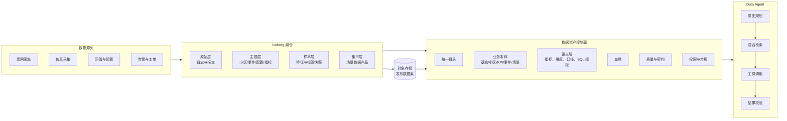
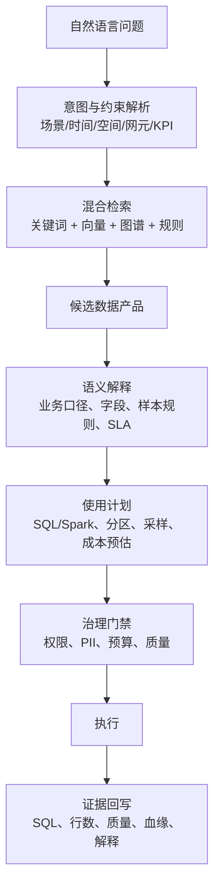
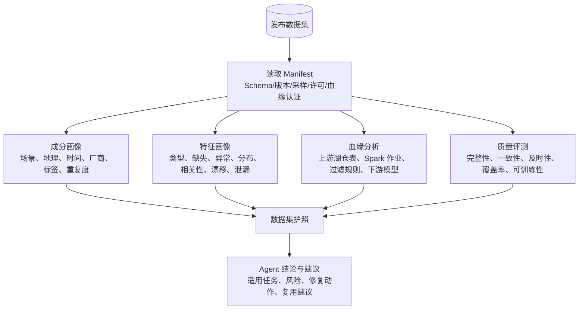
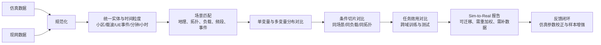

# 无线基站数据资产的 Data Agent 洞察

**一句话**：AI 时代的湖仓竞争力不再是“存得下、算得动”，而是让原始层、主题层、样本层、集市层和对象存储中的发布数据集都变成可发现、可解释、可复用、可评测的数据产品；Data Agent 是把这些产品连接到业务意图的治理化执行层。

> 本页是无线基站大数据与模型训练场景的即时研究回填，尚无对应 `raw/` 来源剪藏。产品能力描述按公开材料与业界通识归纳，后续应以 Databricks、Snowflake、AWS、Microsoft、Google、阿里云及开源项目官方文档复核并补齐来源页。

## 当前上下文

该场景已有三层事实：

1. **采集与建模已完成**：基站日志进入 Iceberg 湖仓，日志模型和场景库成为后续复用的基础。
2. **加工链路明确**：Spark 从湖仓抽取数据，按场景加工成训练样本；发布数据集落对象存储。
3. **痛点集中在消费侧**：业务和算法人员仍需知道“数据在哪里、代表什么、能不能用、来自哪里、和另一批数据差在哪里”。

因此 Data Agent 的核心不是自然语言生成一条 SQL，而是一套受治理约束的任务执行系统：理解意图 → 检索语义资产 → 规划查询与加工 → 校验安全、成本、质量 → 生成结果与证据。

## 总体参考架构

关键设计原则是“湖仓 + 对象存储”双通道，但只有一个资产控制面：

- **湖仓侧**：Iceberg 目录、分区、统计信息、血缘、Schema 演化、权限、Spark/Trino 执行计划共同支撑查询裁剪与成本预估。
- **对象存储侧**：发布数据集不能只是 Parquet/CSV 文件集合，必须是带 Manifest、Schema、样本规则、质量报告、血缘指针和授权信息的可移植数据产品。
- **Agent 侧**：LLM 负责翻译业务意图、选择工具、解释结果；SQL、Spark 任务、画像、血缘和质量检查由确定性工具执行。

## 痛点一：如何在庞大湖仓中按场景和自然语言找到并高效使用数据

### 痛点

基站日志通常横跨网元、小区、用户、事件、指标、配置、时间、地理和厂商等多个维度。仅靠表名搜索无法回答“高铁场景掉线样本在哪里”“哪些数据能支撑干扰优化模型”“这个指标和现网 KPI 是否同一口径”。即使找到表，也要再判断分区、扫描量、权限、成本、质量和下游用法。

### 业界洞察

代表性方案与可借鉴点：

| 业界案例 | 架构与技术方案 | 对本项目的启示 |
|---|---|---|
| Databricks Genie / Unity Catalog / Lakehouse Monitoring | Unity Catalog 统一表、文件、模型、函数权限与血缘；Genie 使用受治理表和语义提示回答问题；Lakehouse Monitoring 做数据画像与漂移监测。 | 把“场景库”注册为可信资产。Agent 只优先检索 Owner、用途、SLA、口径明确的场景资产，而不是全网所有表。 |
| Snowflake Cortex Analyst + Semantic Models | 用语义模型声明指标、维度、同义词、关系和可用问题；Cortex Analyst 基于语义模型生成受约束查询。 | 无线 KPI 需要独立语义层：如“掉线率”“切换成功率”“PRB 利用率”不能只存在于 ETL 代码里。 |
| Microsoft Fabric OneLake + Copilot + Purview | OneLake 做统一湖存储与 shortcut 虚拟化，Copilot 辅助探索和建模，Purview 治理敏感数据。 | 可用“一个逻辑湖 + 多计算引擎”的思路管理仿真和现网数据，同时保留权限与敏感等级。 |
| AWS DataZone / Glue / Athena / S3 Tables / Bedrock Agents | DataZone 做业务目录和数据产品订阅，Glue 提供目录与爬取，Athena/Spark 查询，Bedrock Agent 编排工具。 | “搜索 → 订阅 → 授权 → 查询 → 审计”的流程适合发布数据集，适合把临时取数变成产品化消费。 |
| Google Dataplex / BigQuery column lineage / Looker | Dataplex 提供数据目录、数据画像和治理；BigQuery 提供表和列级血缘；Looker 语义层统一指标口径。 | 列级血缘应进入样本生成链路，回答“标签来自哪列、被哪个规则过滤、影响哪些模型”。 |
| DataHub / OpenMetadata / OpenLineage / Amundsen | 开源组合提供目录、业务描述、所有权、标签、操作元数据、表与列血缘、使用热度。 | 可先落地轻量版：目录 + 向量索引 + 血缘图 + 使用记录，不必等待商业平台全覆盖。 |
| dbt Semantic Layer / Cube / Feast | 分别沉淀指标语义、统一查询接口和特征服务能力。 | Spark 样本加工代码应输出“特征契约 + 样本契约”，供 Agent、训练和复用方共同引用。 |

### 启示

1. **建“场景资产”，不只建“场景表”**。每个场景资产至少包含业务问题、适用小区/时间/事件、KPI 口径、原始层来源、样本规则、负样本策略、Owner、更新频率、授权范围、典型 SQL 和已知限制。
2. **检索返回数据产品，而非只返回 chunk**。混合索引对象包括表、列、KPI、场景、已发布数据集、样本任务、质量报告、看板和历史问答。结果应附 Owner、权限、新鲜度、扫描成本和推荐使用方式。
3. **自然语言入口必须接语义层和治理门禁**。Agent 先识别场景、地理、时间窗、网元、KPI 和合规约束，再选择 SQL/Spark 工具；高风险查询先 dry-run，输出扫描量与费用预估。
4. **用 Iceberg 元数据加速“找到之后怎么用”**。启用分区裁剪、文件级 min/max 裁剪、manifest 统计、Z-order/排序、小文件合并、物化视图、热点场景缓存和采样表；Agent 在执行前解释“为什么这条路径便宜”。
5. **把问答沉淀为可复用技能**。一次成功取数应生成模板化数据产品：参数化 SQL/Spark 作业、数据契约、校验规则、样例解释和血缘快照。下次不是重新对话，而是复用技能。

## 痛点二：如何快速分析发布数据集的成分、特征分布、上下游关系和质量

### 痛点

发布数据集在对象存储中容易被当成“黑盒文件包”：只知道文件路径和训练效果，不知道样本来自哪些小区、时间、场景和厂商，不知道特征是否泄漏、类别是否失衡、上下游规则是否变化、质量是否满足目标模型。人工检查 Schema 和抽样脚本慢，且不可复现。

### 业界洞察

代表性方案与可借鉴点：

| 业界案例 | 架构与技术方案 | 对本项目的启示 |
|---|---|---|
| Databricks Lakehouse Monitoring / Unity Catalog / Feature Store | 自动画像、分布统计、快照对比、表与作业血缘、特征版本管理。 | 发布数据集应自动生成“成分 + 特征 + 漂移 + 血缘”报告，而不是靠算法同学临时跑脚本。 |
| Snowflake Data Metric Functions / Access History / Object Tagging | 内置质量指标、访问历史和标签治理，可发现异常访问和口径变化。 | 发布数据集需要“质量函数 + 访问审计 + 敏感等级”三件套，避免对象存储成为审计盲区。 |
| Monte Carlo / Soda / Great Expectations / dbt tests | 以规则、异常检测和期望测试监控 freshness、volume、schema、null 率、唯一性和分布异常。 | 把无线业务规则写成可执行契约：KPI 范围、小区状态、时间连续性、指标单位、地理边界、标签合法性。 |
| OpenMetadata / DataHub / OpenLineage / Marquez | 统一技术、业务和操作元数据，采集表到列、作业到数据集的血缘。 | Spark 抽样作业必须在启动和结束时写入 OpenLineage 事件，使对象文件能反查到 Iceberg 版本。 |
| Microsoft Purview / Fabric / Power BI semantic model | 从数据源到语义模型再到报表的端到端血缘；治理标签随资产传播。 | 样本、特征、模型评测、看板应共享同一语义口径，避免“训练特征”和“运营指标”两套解释。 |
| Feast / Tecton | 特征定义、离线/在线一致性、特征版本、训练/服务回溯。 | 对样本层和集市层建立特征注册表，记录特征生成 SQL、窗口、聚合方式、默认值和是否可用于训练。 |

### 启示

1. **为每个发布数据集生成“数据护照”**。固定包含：版本、创建时间、生产 Spark 代码、源 Iceberg 快照 ID、过滤与采样规则、行数、文件清单、Schema、单位、标签定义、场景覆盖、质量分数、已知风险、授权和许可证。
2. **成分分析用业务切片，而不只用统计列**。建议默认输出：省份/城市/地形/场景、室外/室内/高铁/密集城区、频段与载波、厂商与型号、工作日/节假日、忙时/闲时、正常/异常、标签正负比、重复样本和近重复样本。
3. **特征分布要看全局和条件切片**。统计缺失率、唯一值、分位数、均值方差、偏度峰度、类别频率、相关矩阵、互信息、异常值、时间漂移、空间漂移、标签泄漏和跨列矛盾。关键特征要有置信区间，而不是只给单一均值。
4. **上下游关系要落到列级血缘**。回答四类问题：数据来自哪些原始层表？经过哪些过滤、聚合、窗口和标签规则？同一规则还影响哪些数据集？下游有哪些模型和报表会受变更影响？
5. **质量评价拆成七维**：完整性、唯一性、一致性、及时性、准确性、覆盖度、可训练性。最后一项包括标签可学性、类别平衡、泄漏检测、训练/验证分布一致性、小场景代表性和模型基线表现。
6. **Agent 输出“体检报告 + 处置动作”**。例如：某小区特征缺失率高则建议剔除或填充；某场景样本不足则建议补充采集；近重复过高则建议按小区和时间去重；训练/测试时间重叠则建议改为时间外推切分；标签可由特征直接推导则阻断训练并提示泄漏。

## 痛点三：如何对比仿真采集与现网采集数据的差异

### 痛点

仿真数据可控、标签充足，但可能缺少真实噪声、异常网元、用户行为、邻区干扰和测量误差；现网数据真实，但存在采样偏差、口径不一致、配置差异和长尾场景稀疏。直接混合训练会引入 sim-to-real 差距；直接评估指标又可能掩盖条件分布和因果机制差异。

### 业界洞察

代表性方案与可借鉴点：

| 业界案例 | 架构与技术方案 | 对本项目的启示 |
|---|---|---|
| Waymo Simulation / Safety Hub | 用真实驾驶日志重建场景、生成挑战场景、做闭环仿真，并用安全指标评估模拟与实路差异。 | 不能只对比全局均值，要构造可复现场景集，比较安全/异常事件的条件分布和模型失败模式。 |
| NVIDIA DRIVE Sim / Omniverse Replicator / Cosmos | 物理仿真、传感器级仿真、可控合成数据、世界模型与真实数据联合评估。 | 基站仿真应输出可追溯的仿真参数：传播模型、用户分布、干扰假设、测量误差和场景种子。 |
| Applied Intuition /自动驾驶数据闭环通用实践 | 场景挖掘、合成数据生成、域随机化、真实边缘案例补齐、模型回归评测。 | 用现网长尾事件反哺仿真场景库，用仿真增强稀缺异常，再用真实集作为最终验收集。 |
| Keysight / Ansys / MATLAB 5G Toolbox 等通信仿真工具链 | 从链路级、系统级、射频/信道到网元行为建模，支持可控实验与协议一致性验证。 | 将仿真工具的物理参数映射进业务本体，否则仿真指标无法与现网 KPI 精准对齐。 |
| MLOps 漂移监测通用实践 | PSI、K-S、Jensen-Shannon、Wasserstein、MMD、adversarial validation、模型性能跨域评估。 | 分布指标必须与任务指标绑定；仅报告统计差异不足以说明能否迁移。 |
| 合成数据评测实践 | fidelity、privacy、utility、coverage 四类评价；重点看下游模型增益和失败样本覆盖率。 | 仿真数据要有独立评分卡：保真度、覆盖度、隐私/合规、下游增益、条件稳定性。 |

### 启示

1. **先统一本体，再比较数值**。统一小区、载波、时间窗、事件定义、测量粒度、单位、空值语义、过滤规则和异常定义。若现网“掉线”与仿真“掉线”口径不同，所有统计差异都会失真。
2. **做场景匹配，而不是全网平均**。构建匹配对：相同城市类型、地形、负载、频段、拓扑、用户分布和事件类型。比较匹配后的条件分布，避免 Simpson's paradox。
3. **分布差异分层报告**。单变量用 PSI、K-S、Jensen-Shannon、Wasserstein；多变量用协方差差异、MMD、adversarial validation；时间和空间还要看自相关、突发性、热点漂移。
4. **机制差异比直方图更重要**。对比同一激励下的响应，例如负载升高时 PRB 利用率、调度失败、切换失败是否呈相似曲线；干扰增强时 SINR、MCS、吞吐量是否保持相似因果方向和时延。
5. **用任务效用作为最终裁判**。设计四组评测：仿真训练→现网测试、现网训练→仿真测试、混合训练→真实测试、现网预训练→仿真/混合微调→真实测试。同时评估准确率、召回率、校准度、长尾表现和失败样本重合度。
6. **输出三类结论**：可直接迁移的特征；需要重加权或归一化的特征；当前不可迁移、需要重新建模或补充采集的特征。每条结论都应绑定场景和业务风险。
7. **让差异驱动仿真和采集闭环**。Agent 发现某类高负载干扰事件缺失后，可自动生成仿真参数建议、补充采集工单或合成样本需求，并把新数据集登记回场景库。

## Data Agent 落地路线

| 阶段 | 能力目标 | 关键交付 |
|---|---|---|
| L1 资产可见 | 表、列、文件、指标、场景、Owner、权限可搜索 | 统一目录、语义标签、血缘、基础质量报告 |
| L2 问答可用 | 自然语言能定位数据并解释口径 | 混合检索、场景语义模型、SQL/Spark dry-run、成本预估 |
| L3 产品可信 | 发布数据集自带契约、质量分和体检报告 | Manifest、数据护照、质量门禁、列级血缘、版本快照 |
| L4 加工自动 | 业务问题能生成参数化样本作业 | 场景模板、特征契约、负样本策略、训练集生成与评测 |
| L5 闭环优化 | 发现缺口后驱动采集、仿真和建模 | 场景缺口分析、仿真/现网差异报告、重加权与样本增强建议 |

## 与其他概念的关联

- 与 [[wiki/concepts/wiki-vs-rag|编译式知识库 vs RAG]] 的共同点是：不能依赖运行时临时拼上下文，应预先把数据资产编译成目录、语义模型、血缘图、质量契约和可执行模板。
- 与现代 Data Mesh 的结合点是：每个主题层、样本层和集市层产品都有 Owner、契约、SLA、质量报告和消费方式。
- 与 AI Agent 的结合点是：LLM 不直接替代数据平台，而是通过受治理工具调用目录、查询引擎、Spark、画像、血缘、质量和权限服务。

## 已知争议或开放问题

- **自然语言问答的边界**：通用 Text2SQL 演示效果好，但无线 KPI、厂商私有字段和业务口径复杂，仍需语义层约束和人工确认。
- **自动画像与业务含义的差距**：缺失率、分布和相关性能发现异常，但不能自动解释所有异常；需要领域规则和专家复核。
- **仿真评估没有单一指标**：统计保真度、场景覆盖度、隐私合规和下游模型增益可能冲突，应根据训练目标加权。
- **湖仓内资产与对象存储数据集的认证打通**：需要对象文件反向追踪到 Iceberg 快照、Spark 作业和源表版本，否则血缘会断链。

## 依据来源

- 当前无 `raw/` 来源剪藏。
- 后续建议优先剪藏：Databricks Genie/Unity Catalog/Lakehouse Monitoring、Snowflake Cortex Analyst/Semantic Models、AWS DataZone/S3 Tables、Microsoft Fabric/OneLake/Purview、Google Dataplex/BigQuery lineage、DataHub/OpenMetadata/OpenLineage、Great Expectations/Soda/Feast、Waymo/NVIDIA/Keysight 仿真数据闭环资料。
